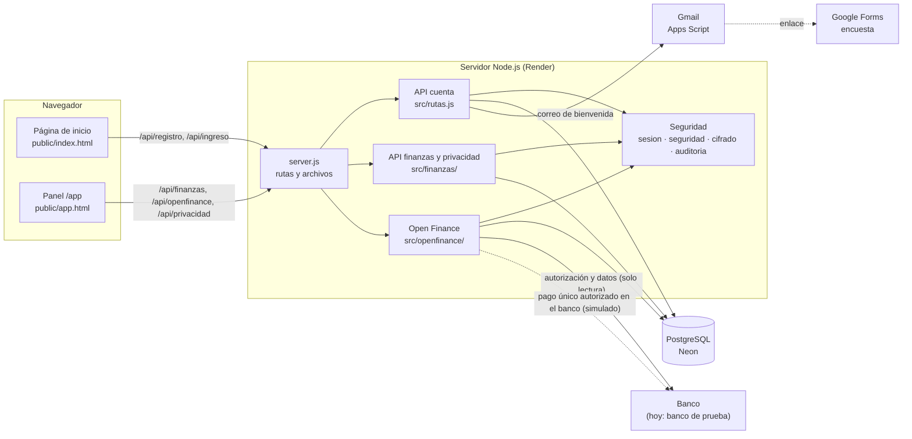

# Arquitectura

Auto-Wealth es **una sola aplicación Node.js** que sirve las páginas y la API desde el mismo servidor y guarda todo en PostgreSQL.

## Principios del diseño

1. **Una sola dependencia externa (`pg`).** Todo lo demás usa lo que trae Node.js: `http` para el servidor, `crypto` para contraseñas, sesiones y cifrado, y `fetch` para los correos. Menos dependencias significa menos vulnerabilidades y nada de "funciona en mi computador".
2. **El servidor decide, la página muestra.** La página valida para dar mensajes rápidos, pero el servidor **vuelve a validar todo**.
3. **Seguro por defecto.** Datos sensibles cifrados, consultas parametrizadas, filtro por `usuario_id` en todo, cabeceras de seguridad y límites de intentos.
4. **Código en español, para que todo el equipo lo entienda:** nombres de funciones, variables, mensajes y comentarios.
5. **Proveedores intercambiables.** El correo (`consola`, `gmail`, `brevo`) y Open Finance (`simulado`, y luego uno real) se eligen con una variable de entorno, sin cambiar el resto del código.

## Recorrido de una petición

Ejemplo: el usuario cambia la categoría de un movimiento.

1. `public/assets/panel.js` hace `fetch('/api/finanzas/movimientos/42', { method: 'PATCH', body: {"categoria":"Mercado"} })`.
2. `server.js`:
   - pone las cabeceras de seguridad;
   - revisa que el `Origin` sea la misma página;
   - busca la ruta en la tabla `API` y extrae `id = 42`.
3. `src/finanzas/rutas.js → actualizarMovimiento`:
   - `exigirUsuario()` (de `src/sesion.js`) lee y verifica la cookie, o responde 401;
   - valida que la categoría exista;
   - llama a `fdb.cambiarCategoria(usuario.id, 42, "Mercado")`.
4. `src/finanzas/db.js` ejecuta `UPDATE movimientos SET categoria = $3 WHERE usuario_id = $1 AND id = $2`. Como filtra por `usuario_id`, si el movimiento es de otra persona no cambia nada y se responde 404.
5. La respuesta `{ "ok": true }` vuelve a la página, que muestra "Categoría actualizada".

## Mapa del código y responsables

| Carpeta / archivo | Qué contiene | Responsable |
|---|---|---|
| `server.js` | Arranque, tabla de rutas, archivos estáticos | Juanes (rutas) · Samu (arranque) |
| `src/rutas.js`, `src/finanzas/rutas.js`, `src/openfinance/index.js` | Lógica de la API | **Juanes** |
| `src/validacion.js` | Validación de datos de entrada | Juanes |
| `src/finanzas/analisis.js`, `src/finanzas/categorias.js` | Cálculos del resumen, del plan para el dinero ocioso y clasificación | Juanes (con David para lo que se muestra) |
| `src/finanzas/deudas.js`, `src/openfinance/pagos.js` | Deudas, plan y pagos simulados | Juanes |
| `src/schema.sql`, `src/db.js`, `src/finanzas/db.js` | Estructura y consultas de la base de datos | **Garavito** |
| `src/auditoria.js` | Registro de actividad | Garavito |
| `src/openfinance/simulado.js` | Banco de prueba | Juanes |
| `public/index.html`, `public/assets/inicio.*`, `public/privacidad.html` | Página de inicio y páginas legales | **Aleja** |
| `public/app.html`, `public/assets/panel.*` | Panel financiero | **David** |
| `src/seguridad.js`, `src/sesion.js`, `src/cifrado.js`, `src/http.js`, `src/config.js` | Seguridad y configuración | **Samu** |
| `src/correo.js`, `apps-script/` | Correos | Samu |
| `src/admin.js` | Panel de administración | Garavito |
| `tests/`, `.github/` | Pruebas y revisión automática | Samu (todos escriben pruebas de su parte) |
| `docs/` | Documentación | Cada uno, la de su área |

"Responsable" significa que esa persona revisa y aprueba los cambios en esos archivos, no que nadie más pueda tocarlos.
