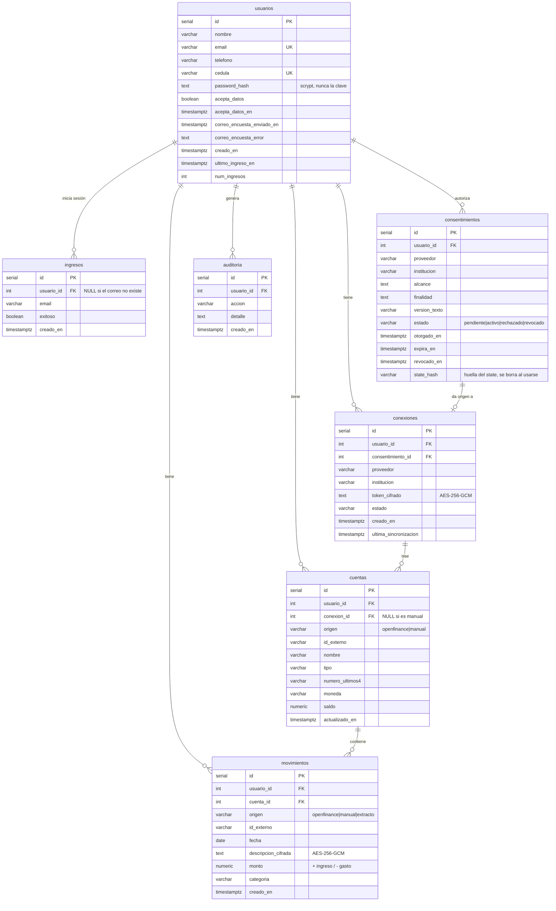

# Base de datos

> **Responsable:** Garavito. Los archivos de esta área son `src/schema.sql`, `src/db.js`, `src/finanzas/db.js` y `src/auditoria.js`.

- **Motor:** PostgreSQL 16, alojado en [Neon](https://neon.com) (plan gratuito: 0,5 GB, sin vencimiento).
- **Conexión:** variable `DATABASE_URL`. Librería `pg` (`src/db.js`), con máximo 5 conexiones simultáneas.
- **Estructura:** `src/schema.sql`. El servidor lo ejecuta **cada vez que arranca**. Todo usa `CREATE TABLE IF NOT EXISTS` / `CREATE INDEX IF NOT EXISTS`, así que repetirlo nunca borra datos.

## Diagrama



## Tablas

| Tabla | Para qué | Reglas importantes |
|---|---|---|
| `usuarios` | Personas registradas | `email` y `cedula` únicos. El `email` se guarda en minúsculas |
| `ingresos` | Cada intento de inicio de sesión | Sirve para detectar ataques y para el panel `/admin` |
| `consentimientos` | Autorizaciones de Open Finance | **Es la prueba legal del consentimiento**: no se borra al revocar, se marca `revocado`. Guarda la versión del texto aceptado |
| `conexiones` | Bancos conectados | `token_cifrado`: la credencial del proveedor, **siempre cifrada** |
| `cuentas` | Cuentas del banco o manuales | Solo `numero_ultimos4`, **nunca** el número completo. Única por `(conexion_id, id_externo)` |
| `movimientos` | Ingresos y gastos | `descripcion_cifrada` va **cifrada**. Única por `(cuenta_id, id_externo)`: así sincronizar o importar dos veces no duplica |
| `auditoria` | Historial de acciones sobre datos financieros | El usuario ve el suyo en "Privacidad". Las acciones válidas están en `src/auditoria.js` |

### Qué pasa al borrar
- **Eliminar un usuario** borra en cascada todo lo suyo (`ON DELETE CASCADE`).
- **Eliminar una conexión** (revocar banco) borra sus cuentas y, en cascada, sus movimientos.
- **Eliminar una cuenta** borra sus movimientos.

### Índices
`ingresos(usuario_id)`, `ingresos(creado_en)`, `consentimientos(usuario_id)`, `conexiones(usuario_id)`, `cuentas(usuario_id)`, `movimientos(usuario_id, fecha DESC)` y `auditoria(usuario_id, creado_en DESC)`. Las consultas del panel siempre filtran por `usuario_id` y fecha.

## Reglas para escribir consultas

1. **Siempre parámetros** `$1, $2…`. Nunca pegues texto del usuario dentro del SQL. Esto evita la "inyección SQL".
   ```js
   // ✅ Bien
   pool.query('SELECT * FROM cuentas WHERE usuario_id = $1 AND id = $2', [usuarioId, id]);
   // ❌ Nunca
   pool.query(`SELECT * FROM cuentas WHERE id = ${id}`);
   ```
2. **Toda consulta de datos financieros filtra por `usuario_id`**, incluso cuando ya tienes el `id` del registro. Así nadie puede ver lo de otra persona cambiando un número.
3. **Fechas:** devuélvelas como texto con `to_char(fecha, 'YYYY-MM-DD')` para evitar problemas de zona horaria.
4. **Números:** `NUMERIC` llega como texto desde `pg`. Usa `::float8` en el SQL o `Number()` en JavaScript.
5. **Muchas filas:** inserta en una sola consulta con `json_to_recordset` (ver `insertarMovimientos` en `src/finanzas/db.js`).
6. **Datos sensibles nuevos** (descripciones, notas, tokens): se guardan con `cifrar()` de `src/cifrado.js`.

## Cambios a la estructura (migraciones)

Hoy no hay un sistema de migraciones: `schema.sql` solo **agrega**. Para cambiar la estructura:
- **Tabla nueva:** agrégala al final de `schema.sql` con `CREATE TABLE IF NOT EXISTS`.
- **Columna nueva:** `ALTER TABLE tabla ADD COLUMN IF NOT EXISTS columna tipo;` al final del archivo.
- **Nunca** borres ni renombres columnas en `schema.sql` sin hablarlo con el equipo: Render ejecuta el archivo al arrancar, contra los datos reales.

## Tablas planeadas para este mes

> ✏️ Propuesta para que Garavito la confirme con Juanes en la Semana 1.

```sql
-- Presupuesto mensual por categoría de gasto
CREATE TABLE IF NOT EXISTS presupuestos (
    id          SERIAL PRIMARY KEY,
    usuario_id  INTEGER NOT NULL REFERENCES usuarios(id) ON DELETE CASCADE,
    categoria   VARCHAR(40)   NOT NULL,
    limite      NUMERIC(16,2) NOT NULL CHECK (limite > 0),
    creado_en   TIMESTAMPTZ   NOT NULL DEFAULT now(),
    CONSTRAINT presupuestos_unico UNIQUE (usuario_id, categoria)
);

-- Metas de ahorro y sus aportes
CREATE TABLE IF NOT EXISTS metas (
    id            SERIAL PRIMARY KEY,
    usuario_id    INTEGER NOT NULL REFERENCES usuarios(id) ON DELETE CASCADE,
    nombre        VARCHAR(80)   NOT NULL,
    objetivo      NUMERIC(16,2) NOT NULL CHECK (objetivo > 0),
    fecha_limite  DATE,
    creado_en     TIMESTAMPTZ   NOT NULL DEFAULT now()
);
CREATE TABLE IF NOT EXISTS aportes_meta (
    id          SERIAL PRIMARY KEY,
    meta_id     INTEGER NOT NULL REFERENCES metas(id) ON DELETE CASCADE,
    usuario_id  INTEGER NOT NULL REFERENCES usuarios(id) ON DELETE CASCADE,
    valor       NUMERIC(16,2) NOT NULL,
    fecha       DATE          NOT NULL,
    creado_en   TIMESTAMPTZ   NOT NULL DEFAULT now()
);

-- Recuperación de contraseña (solo se guarda la HUELLA del token)
CREATE TABLE IF NOT EXISTS tokens_recuperacion (
    id          SERIAL PRIMARY KEY,
    usuario_id  INTEGER NOT NULL REFERENCES usuarios(id) ON DELETE CASCADE,
    token_hash  VARCHAR(64) NOT NULL UNIQUE,
    expira_en   TIMESTAMPTZ NOT NULL,
    usado_en    TIMESTAMPTZ,
    creado_en   TIMESTAMPTZ NOT NULL DEFAULT now()
);

-- Para cerrar todas las sesiones al cambiar la contraseña
ALTER TABLE usuarios ADD COLUMN IF NOT EXISTS version_sesion INTEGER NOT NULL DEFAULT 0;
```

## Entornos (ramas de Neon)

Neon permite **ramas**: copias de la base de datos que no afectan a las demás.

| Rama | Quién la usa | Para qué |
|---|---|---|
| `main` | Render (producción) | Usuarios reales. **Nadie** la usa en su computador |
| `dev-<nombre>` | Cada integrante | Desarrollo en su computador (`DATABASE_URL` de su `.env`) |
| `pruebas` | `npm test` en cada computador | Las pruebas crean usuarios de prueba |

En GitHub, las pruebas usan una base de datos temporal que se crea y se borra sola (ver `.github/workflows/ci.yml`).

## Consultas útiles (SQL Editor de Neon)

```sql
-- Registros por día (últimos 30 días)
SELECT creado_en::date AS dia, count(*) FROM usuarios
WHERE creado_en > now() - interval '30 days' GROUP BY 1 ORDER BY 1;

-- Personas a las que no les llegó el correo de la encuesta
SELECT nombre, email, correo_encuesta_error FROM usuarios WHERE correo_encuesta_enviado_en IS NULL;

-- Autorizaciones de Open Finance por estado
SELECT estado, count(*) FROM consentimientos GROUP BY estado;

-- Intentos de ingreso fallidos en la última hora (posibles ataques)
SELECT email, count(*) FROM ingresos
WHERE NOT exitoso AND creado_en > now() - interval '1 hour' GROUP BY email ORDER BY 2 DESC;

-- Tamaño de cada tabla
SELECT relname AS tabla, pg_size_pretty(pg_total_relation_size(relid)) AS tamano
FROM pg_catalog.pg_statio_user_tables ORDER BY pg_total_relation_size(relid) DESC;
```

> Las descripciones de los movimientos se ven como `v1:...` en Neon porque están cifradas. Eso es correcto: solo el servidor, con `DATA_ENCRYPTION_KEY`, puede leerlas.
