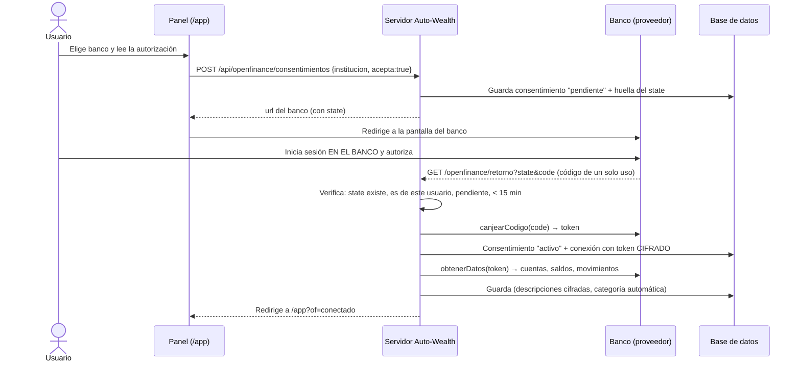

# Open Finance

## Qué es y dónde está Colombia

**Open Finance (finanzas abiertas)** permite que una persona autorice a una aplicación a **consultar** su información financiera (cuentas, saldos, movimientos) directamente desde su banco, sin compartir su clave.

- **Decreto 1297 de 2022:** primer marco de finanzas abiertas en Colombia (voluntario).
- **Circular Externa 004 de 2024 (Superintendencia Financiera):** estándares técnicos iniciales.
- **Decreto 0368 de 2026 (7 de abril de 2026):** hace **obligatorio** el sistema para las entidades vigiladas por la SFC. La SFC administra un directorio de participantes y publica el cronograma de estándares. Los bancos tienen 12 meses desde esa publicación para habilitar el acceso a cada tipo de datos.
- **Hoy (octubre de 2026)**, las APIs estándar todavía no están abiertas para cualquier aplicación. Por eso Auto-Wealth usa un **banco de prueba** con el mismo flujo que tendrá uno real.

## El flujo en Auto-Wealth

### Elementos del consentimiento (Decreto 0368)
La pantalla de autorización y la tabla `consentimientos` registran:
- **quién recibe** los datos (Auto-Wealth);
- **qué datos** (cuentas, saldos, movimientos de 12 meses);
- **para qué** (finalidad);
- **por cuánto tiempo** (12 meses, configurable con `CONSENT_MONTHS`);
- la **versión del texto** aceptado y las fechas.

El texto está en `textoConsentimiento()` de `src/openfinance/index.js`. **Si se cambia, hay que subir `VERSION_TEXTO`.**

### Seguridad del flujo
| Riesgo | Protección |
|---|---|
| Que alguien use la autorización de otra persona | El `state` solo lo puede completar el usuario que lo creó (se compara con la sesión) |
| Que se reutilice un regreso del banco | El `state` se borra al usarse y el `code` es de un solo uso (5 min) |
| Robo de la base de datos | El token del banco y las descripciones están cifrados con AES-256-GCM |
| Acceso indefinido | Las autorizaciones vencen. Sincronizar con una vencida responde 409 |
| El usuario cambia de opinión | Revocar avisa al proveedor y borra los datos de ese banco |

## El proveedor de prueba (`src/openfinance/simulado.js`)
- Bancos **ficticios**: Banco Ceiba, Banco Andes Unión y Colibrí (billetera). **No usar nombres de bancos reales** en el simulador.
- La pantalla del banco muestra una franja amarilla de **ENTORNO DE PRUEBAS** y **no tiene campo de clave**, para no acostumbrar a nadie a escribir claves reales en una página falsa.
- Genera 12 meses de movimientos realistas (nómina, arriendo, servicios, Rappi, Uber, suscripciones…). Usa una semilla fija por usuario y banco: siempre los mismos datos, y sincronizar no duplica.

## Cómo conectar un proveedor real
Crear `src/openfinance/<proveedor>.js` con estas funciones y registrarlo en `PROVEEDORES` de `src/openfinance/index.js`:

| Función | Recibe | Devuelve |
|---|---|---|
| `nombre` | — | texto, ej. `"agregador"` |
| `instituciones()` | — | `[{ id, nombre, tipo }]` |
| `institucionPorId(id)` | id | banco o `null` |
| `urlAutorizacion({ state, institucion, alcance, meses, receptor })` | — | URL del banco a la que se envía al usuario |
| `canjearCodigo({ code, state })` | código del regreso | `{ token }` |
| `obtenerDatos({ token, usuarioId })` | — | `{ cuentas: [{ idExterno, nombre, tipo, ultimos4, saldo }], movimientos: [{ idExternoCuenta, idExterno, fecha, descripcion, monto }] }` |
| `revocar({ token })` | — | avisa al banco |
| `manejarRuta(req, res, ruta, url)` *(opcional)* | — | solo si el proveedor necesita páginas propias |

Luego se agrega el nombre a la lista permitida en `src/config.js` y se cambia `OPEN_FINANCE_PROVIDER`. El panel, el cifrado, el consentimiento y la privacidad no cambian.

**Antes de conectar bancos reales:** ver la lista de [seguridad-y-cumplimiento.md](seguridad-y-cumplimiento.md).
